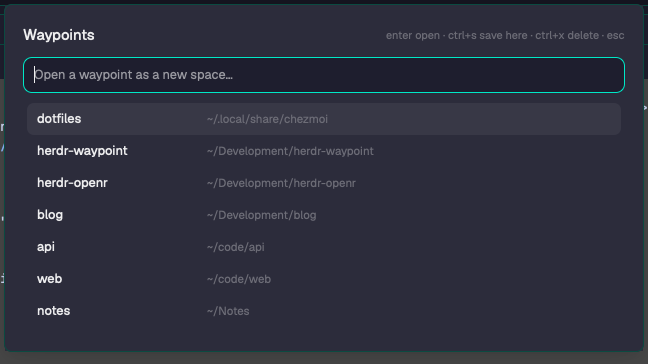

# Waypoint

A popup listing named folders you saved. Type a few letters, press Enter and the folder opens as a
new space with the waypoint's name.

## What you see

- A popup at the top of the window, 640px wide and 0.6 of the window high, with a `popover`
  background and 18px padding.
- Header row: "Waypoints" in 15px semibold `foreground` on the left. A `dim` 11px key hint on the
  right: `enter open · ctrl+s save here · ctrl+x delete · esc`.
- A 36px input with a 1px `accent` border, 9px radius and `background` fill. Placeholder: "Open a
  waypoint as a new space…".
- Up to 12 rows, 32px high with a 7px radius. Each row shows the name (160px column, `foreground`,
  truncated) and the path (11.5px `dim`, with the home folder shortened to `~`). The selected row and
  hovered rows get `hover` as background.
- With no waypoints: "No waypoints yet: ctrl+s saves the focused folder". With no match: "No match".

## How it behaves

- Typing filters by subsequence over name and path, case-insensitive: `hwp` finds `herdr-waypoint`.
  The selection resets to the first row.
- Up/Down (or ctrl+p/ctrl+n) move the selection. The list scrolls so the selection stays visible.
- Enter or a click closes the popup and runs `space.new {name, folder}` for that waypoint.
- ctrl+s saves the folder of the terminal that was focused when the popup opened. Its name is the
  current space's name, or the folder's basename when there is none. Saving a folder that is
  already stored replaces its name. A success toast reads "saved: <name>".
- ctrl+x deletes the selected waypoint.
- Esc closes the popup.

## Built from

- `mods/waypoint/mod.json`: `place: "none"` and an overlay `{kind: "popup", at: "top", offset: 40,
  width: 640, height: 0.6}`. `keys.json` binds `cmd-shift-n` to `mod.open:waypoint`.
- `main.js`: one `View`, with `v_flex`, `h_flex`, `InputState` and `Input` from gpui-base.
- `herdr`: `readTextFile` and `writeTextFile` (the expected text is the last read, so concurrent
  edits are not lost silently), `exec("mkdir", ["-p", dir])`, `focused()` for `cwd` and `space`,
  `spaces()` for the space name, `run("space.new")`, `notify`, `closeOverlay(props().overlay)`,
  and `theme()`.
- Store: `<appHome>/data/waypoint/waypoints.tsv`, one `name<TAB>path` line per waypoint. The
  format matches the Herdr TUI plugin, so its `waypoints.tsv` can be copied over as it is.

## Watch out

- Read `focused()` in `init`. Once the popup has the keyboard, the focus no longer describes the
  terminal the person was in.
- Focus the input again after about 600ms (`cx.timer.after`). The overlay can take focus after
  `init` runs.
- The rows are a slice of 12 around the selection, not a virtual list.
- Rename is not built. Delete the waypoint, then save it again under the new space name.
- The path is not checked when you open it. A deleted folder fails in `space.new`.

## Done when

- `herdr-app check mods/waypoint` passes.
- `cmd-shift-n` opens the popup with the saved waypoints. Typing narrows the list and Enter opens a
  new space named after the waypoint, in its folder.
- ctrl+s in a terminal's folder adds a row and shows the toast. ctrl+x removes that row, and
  `waypoints.tsv` changes to match.
